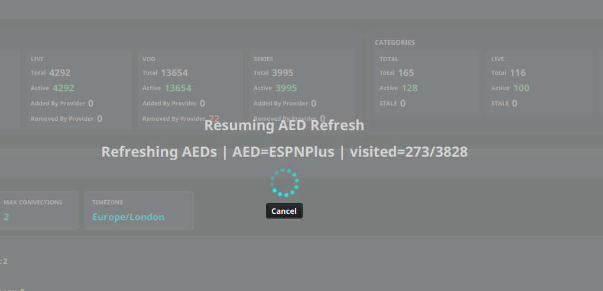
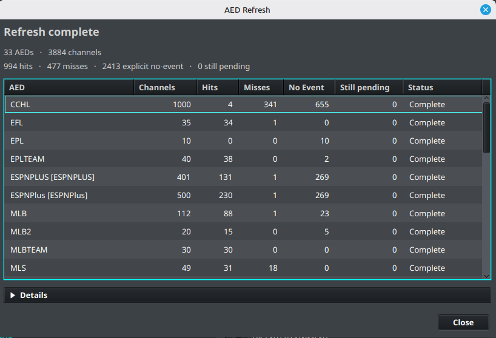
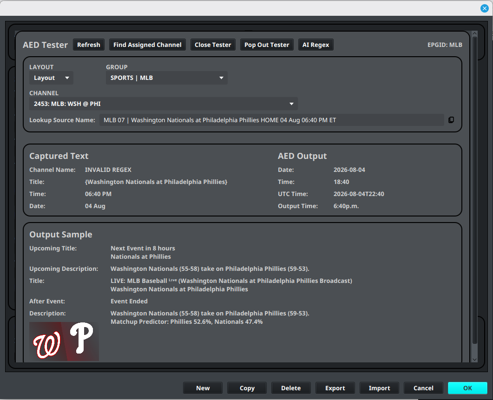
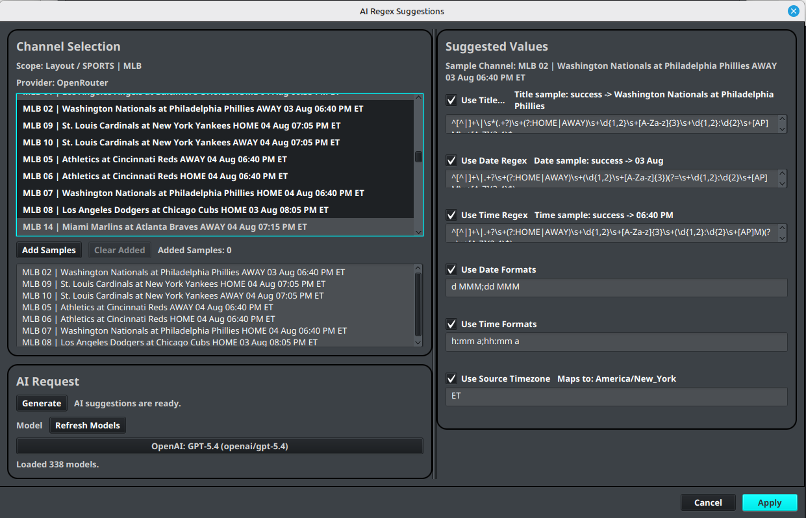
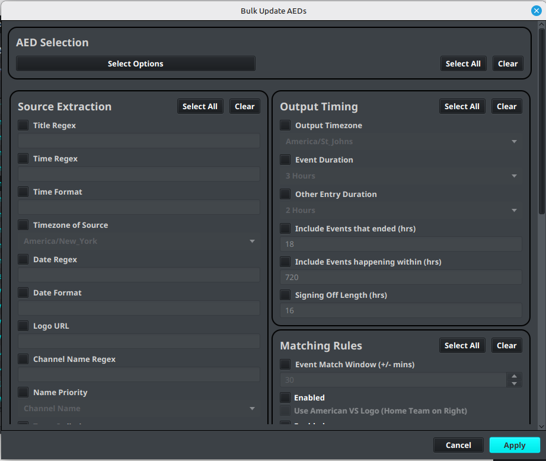

# Manage and Refresh AEDs

PRO [See Free vs Pro](../getting-started/free-vs-pro.md).

Use [Dummy Guide Inventory](../setup/dummy-guides.md) to find definitions and check where they are used. For setup concepts, see [Advanced EPG Dummies](aed.md); for field syntax, see [AED Templates and Regex](aed-reference.md).

## Test and refresh an AED

1. Open the AED tester from the AED workflow.
2. Paste representative provider channel names, including a channel with no active event.
3. Confirm the regex captures map to the intended placeholders.
4. Check the generated name, description, and logo URL.
5. Save the AED only after the results are correct.
6. Refresh the assigned AED channels and inspect the result in the Layout Editor.

Recognized short team names with numeric stream suffixes, such as `Wigan (1)`, `Wigan (2)`, and `Hull (1)`, are eligible for matching even if their display names have been changed. Capitalization and surrounding whitespace are ignored for this check. Explicit no-event markers still take precedence; a numbered stream name does not guarantee an event match.

After a successful playlist source sync, eligible sports channels that previously had no match are retried automatically. Retries search the full configured window using the available sports data, even when the provider name and dataset have not changed. An event already in the dataset can therefore match when it enters the output window. A miss remains eligible for a later refresh; explicit no-event markers are still respected.

Eligible channels using a fallback AED are also checked for a match in earlier sports definitions in their fallback chain. This can replace the fallback with a matching earlier definition without requiring new sports data. If no earlier definition matches, the existing fallback is preserved. A match to an intermediate definition can still be promoted to the primary definition on a later refresh.

Saving an AED can retry eligible unmatched channels or check eligible fallback assignments even when matching settings are unchanged. If a channel still has no event, confirm that the sports data is available, the AED is assigned, and the provider name or custom lookup name matches the AED rules before using **Refresh AEDs** manually.

### Name priority and no-event results

In **3.12.30 and later**, AED name priority controls which name is tried first. An unusable or unmatched edited name still allows the original provider name to be tried, and vice versa. Prefer the provider name when edited names are cosmetic labels without event details.

An explicit provider **NO EVENT** marker blocks normal matching regardless of name priority; existing [custom sports TXT lookup overrides](../setup/custom-sports-channel-names.md) remain supported. Short names, numbered slots, blank names, and placeholder endings produce a hard **No Event** result only when neither name is usable. When usable names find no match, the configured fallback AED and normal retry behavior still apply.

Normal refresh also re-evaluates stored hard **No Event** results. Incorrect rejections from earlier versions can resume full-window matching without a database restore or changes to names or settings. Legitimate provider no-event markers remain respected.

After saving an AED, selecting **OK** with no further form changes closes the editor without saving or queuing the same refresh again.

### Test Other Sports matching

For [Other Sports AEDs](aed.md#other-sports-aeds), test both a full event name and a participant-only channel name. A participant-only name must identify the player or driver unambiguously in the relevant listings. Include a deliberately incorrect name to check that it does not match.

For tennis names such as `Guo H` or `H. Guo`, enable abbreviation matching. Name/display-name matching and fuzzy matching alone do not enable these abbreviations. Doubles matching supports either name order and listings without athlete IDs or short names, but both partnerships must agree: incorrect initials or mixed-up partners should produce no match. A surname shared by multiple participants is not sufficient to select one of them.

For fight and racing channels, compare a broad card or event name with a specific bout, segment, session, or driver-camera name. Check that the result has the intended scope and that sequential programmes fit the AED's output window. Team-location matching does not apply to these listings.

After saving, refresh assigned channels and inspect both their output names and programme preview. Matching in the tester and inclusion in output remain separate checks.

### Match tennis tournament sessions

In **3.12.27 and later**, a tennis AED can match eligible individual matches from a tournament session without player names. Select the relevant sports and leagues, then test provider names or [TXT fixture names](../setup/custom-sports-channel-names.md) such as:

| Lookup name | Intended selection |
| --- | --- |
| `ATP 250 Tennis: Stockholm Semifinals` | Stockholm men's semifinals |
| `WTA Finals: Singles & Doubles Semifinals` | Women's singles and doubles semifinals at the WTA Finals |
| `ATP Finals Doubles Round Robin` | Men's doubles round-robin matches at the ATP Finals |

`ATP Finals` and `WTA Finals` identify tournaments; the word `Finals` inside those names does not restrict matches to the final round. Add a separate round hint when needed. Supported round hints include semifinals (`SF`), quarterfinals (`QF`), finals, and round robin (`RR`).

Configure **Date Regex**, **Time Regex**, their formats, and **Source Timezone** when the lookup includes a timestamp. A `Day #N` label requires both a parsed date and time: IPTVBoss does not convert tournament day numbers into calendar dates. For example, `ATP Finals Doubles Round Robin Day #2 (2026-11-16 05:30:00)` needs regex settings that extract that date and time.

Matches are ordered by start time within the existing **Event Match Window** and output limits. If the broadcast covers a longer session, adjust the configured window to include the intended matches. Each match keeps its own title, summary, artwork, and event identity. Existing overlap handling still applies; a tournament session match does not identify which court the provider is showing.

Ambiguous tournament names, conflicting tour or round hints, and unsupported session wording produce no match. For example, correct the lookup name for `Indian Wells: Day 6 WTA Finals` before retrying. Explicit player matchups continue to use participant matching; a failed matchup does not become a generic tournament schedule. Provider EPG descriptions are not searched, and unavailable, withdrawn, or incomplete matches are excluded.

After saving, refresh the assigned channels and check both the programme preview and generated guide against the broadcast you expect.

### Understand matches outside the output window

The tester can show a matching event even when it is outside the AED's configured output inclusion window. **Matched — outside output inclusion window.** means the lookup matched, but that event does not currently qualify for output. The tester uses current form values, including unsaved matching edits; a successful tester match alone does not mean the event will be exported.

Review the event time and the AED's keep-period settings, then refresh and inspect the generated guide. Do not widen the output window solely to remove the notice unless those additional events should actually appear.

### Refresh AED results

Use **Sources** → **AED Refresh…** when you need to refresh AED results beyond the currently selected group. Choose one of the following actions:

- **Refresh All** checks all configured AED channels and recalculates their current results.
- **Refresh Pending** continues queued AED work left by an earlier interrupted, paused, or incomplete refresh. It does not replace a full refresh for channels that were never queued.

The **Refresh AEDs** button in the Layout Editor still refreshes the AED channels in the selected group. A refresh can run in the background while the progress overlay shows the current AED and the number of visited channels. Select **Cancel** to request a pause; IPTVBoss finishes the current request before stopping. Start **AED Refresh…** → **Refresh Pending** later to continue queued work.

When the refresh finishes, the **AED Refresh** summary shows totals for AEDs and channels, plus **hits**, **misses**, **explicit no-event**, and **still pending** work. The table breaks those metrics down for each AED and includes the refresh **Status**. Expand **Details** for failed, discarded, superseded, and not-processed counts. A non-zero **still pending** value means that queued work remains and should be handled with **Refresh Pending** or another full refresh, as appropriate.

Include examples from different leagues, event states, and provider naming variations. A pattern that works for one event may silently produce empty placeholders for another.

## Related tools

### AI Regex Suggestions

**AI Regex Suggestions** can examine representative channel names and suggest values for the fields most likely to vary by provider, including Title Regex, Date Regex, Time Regex, Date Format, Time Format, and Source Timezone.

To use it, select representative channels, add samples from the source, generate suggestions, and review each suggested value before applying it. Include multiple naming variations when possible. AI-generated regex is a starting point, not a guarantee that every channel will match. Test the applied AED in the tester and inspect the generated event before assigning it broadly.

AI Regex Suggestions requires a configured AI provider and model. See [AI Settings](../settings/ai.md) for provider setup and troubleshooting.

### AED Bulk Updater

**AED Bulk Updater** applies selected field changes to several AEDs at once. Select the AEDs to update, enable only the fields that should change, enter or choose the new values, and apply the update. It can be used for shared extraction settings such as regex and formats, output timing settings, matching rules, logos, and enabled-state options.

Use it when several AEDs need the same correction, such as a provider changing from 12-hour to 24-hour times or a timezone setting changing. Review the selected AEDs and enabled fields carefully: any selected field can replace the existing value on every chosen AED. Test representative AEDs after a bulk update and refresh their assigned channels when the results are correct.

Other AED tools include:

- **AED Defaults** stores reusable output and matching defaults.
- **Import AED(s)** and **Export AED(s)** move AED definitions between installations.
- **Reload Sports Data** refreshes the sports data used by sports AED workflows.
- **Reload TXT Channel Names** reloads text-based channel names when that source workflow is in use.
- **AED Refresh…** opens the refresh choices for all configured AED channels or queued work that can be resumed.

AED tools may depend on the account plan and application release. If a menu item is locked, check account access before troubleshooting the definition.
