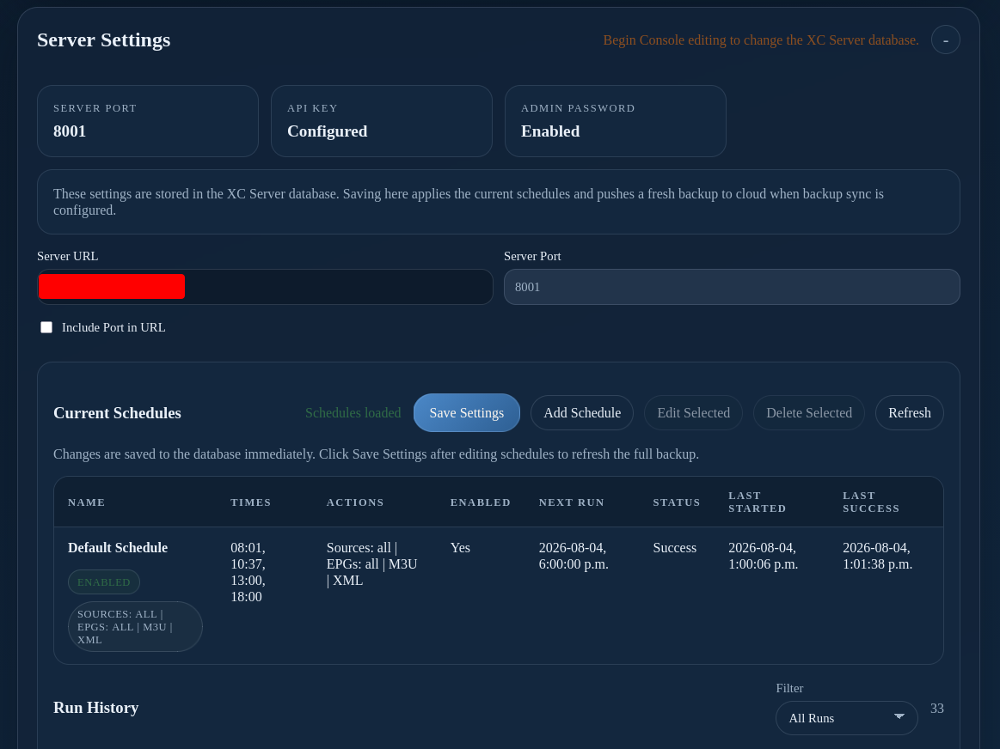

# Server Console: Server Settings

--8<-- "includes/xc-server-pro.md"

Use **Server Settings** in the web frontend to configure the public server address and synchronization schedules. Saving settings may push a fresh backup to the configured cloud provider.

1. Enter the server address in **Server URL**.
2. Review the listening port in **Server Port**.
3. Enable **Include Port in URL** when the public address requires it.
4. Review the displayed connection address.
5. Select **Save Settings**.

Use an address reachable by paired desktop installations. Do not use `localhost` or `127.0.0.1` when another computer must connect.

## Current Schedules

1. Select **Add Schedule**.
2. Choose the required source, EPG, M3U, or XML synchronization actions.
3. Choose the run times and enable the schedule.
4. Select **Save Settings**.
5. Confirm the schedule’s next run and status.

Use **Edit Selected**, **Delete Selected**, and **Refresh** only after confirming the intended schedule. Review the next run, status, last started time, last success, and run history after saving.

## Before a server sync starts

In **3.12.30 and later**, a scheduled or manual server-local NoGUI run pauses credential refresh and publishes pending user changes to the configured backup destination before it starts. Credential refresh resumes after the run finishes.

If publication fails or cannot be confirmed, the run is deferred. Review the schedule history and [server logs](logs.md), resolve the reported blocker, then retry. This protection applies to NoGUI runs inside XC Server; separate installations continue to use their existing cloud coordination and reconciliation workflow. See [A server sync was skipped or deferred](../troubleshooting.md#a-server-sync-was-skipped-or-deferred).
